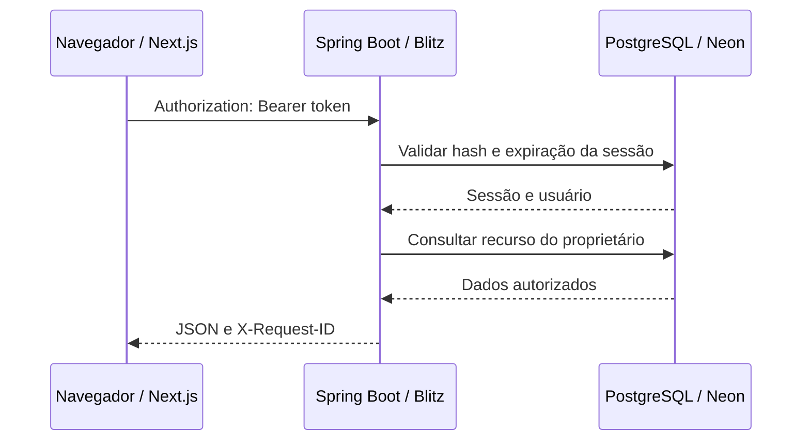

# Arquitetura do Orquestria

## Visão geral

O Orquestria separa a apresentação, a API e a persistência em serviços com publicação independente.

```text
Navegador
   │
   ├─ Netlify — Next.js 14 / React / TypeScript (site estático)
   │      │
   │      ├─ HTTPS / JSON → Blitz — Spring Boot / Java 21
   │      │                         │
   │      │                         └─ JDBC / TLS → Neon — PostgreSQL
   │      │
   │      └─ /api/orquestria-readiness → proxy Netlify → /actuator/health
   │
   └─ localStorage — token de sessão e preferências de interface
```

A variável pública de build `NEXT_PUBLIC_ORQUESTRIA_API_URL` determina o endereço utilizado para as chamadas à API no frontend. Segredos de banco pertencem exclusivamente ao backend.

## Frontend

O [frontend](../frontend/README.md) utiliza Next.js com `output: "export"`: após o build, o Netlify publica arquivos estáticos, sem processo Next.js persistente. A interface emprega Zustand para estado do quadro, TanStack Query para consultas e React Hook Form/Zod para formulários.

O Kanban exibe workspaces, projetos, colunas e tarefas. Operações de escrita feitas no modo remoto enviam requisições HTTP para a API e atualizam os dados apresentados. Criar ou renomear colunas e projetos, criar, editar ou mover tarefas e incluir/excluir comentários reutiliza a resposta JSON da própria mutação para atualizar o item, sem recarregar os projetos inteiros. Exclusões confirmadas também atualizam a coleção local; o recarregamento manual continua disponível para reconciliação. A listagem de tarefas utiliza busca conjunta dos comentários para reduzir o número de consultas ao banco. O projeto também mantém um modo de demonstração local utilizado quando não há URL de API configurada; esse modo não representa os dados do PostgreSQL.

## API e persistência

A API Spring Boot concentra autenticação, validações, acesso aos recursos e regras de integridade. Spring Data JPA/Hibernate é usado no domínio; as exclusões de itens do Kanban também utilizam operações SQL transacionais para respeitar dependências e reordenar posições.

O Flyway controla a evolução do esquema. As migrações versionadas são:

| Versão | Mudança |
| --- | --- |
| V1 | Cadastro de projetos |
| V2 | Workspaces, colunas e tarefas |
| V3 | Detalhes de tarefas e comentários |
| V4 | Contas, sessões e propriedade dos recursos |
| V5 | Nomes de usuário únicos |
| V6 | Membros de equipe |
| V7 | Catálogo de tags por conta |
| V8 | Migração de tags anteriores para o catálogo |
| V9 | Metadados de atividade e retenção das contas |

Migrações aplicadas não são reescritas. Alterações de estrutura devem ser introduzidas por novas versões.

## Identidade e autorização

O Spring Security utiliza sessões identificadas por tokens Bearer aleatórios. A API armazena o hash SHA-256 do token e usa BCrypt para senhas. O token enviado ao navegador é armazenado no `localStorage`, permitindo a restauração da sessão após atualização ou abertura de uma nova aba. O cliente remove o token ao sair da conta. O armazenamento no navegador exige proteção contra XSS e não substitui a autorização no servidor.

Workspaces e projetos pertencem a uma conta. As rotas privadas verificam a identidade e a titularidade antes de consultar ou modificar registros. A conta **guest** permite uma demonstração pública e seus dados são compartilhados; contas pessoais têm dados isolados.

A lista de equipe serve para escolher responsáveis por tarefas. A inclusão de um usuário na equipe **não concede acesso aos workspaces ou projetos privados**. O sistema não implementa edição colaborativa multiusuário com permissões compartilhadas.

## Regras de integridade

- Colunas com tarefas não podem ser excluídas, incluindo tarefas ocultas por filtros na interface.
- Workspaces com projetos não podem ser excluídos até que esses projetos sejam removidos ou transferidos.
- A exclusão de um projeto elimina suas tarefas, colunas e comentários relacionados.
- Responsáveis precisam ser o proprietário ou um membro cadastrado da equipe.
- A remoção de membros com tarefas atribuídas é bloqueada até reatribuição.
- Tags são mantidas em um catálogo associado à conta. Alterações no catálogo não reescrevem automaticamente as tags gravadas em tarefas anteriores.

## Inicialização da API

A infraestrutura da API pode suspender o processo por inatividade. Antes de exibir login ou Kanban, `ApiReadinessGate` consulta `/api/orquestria-readiness` no domínio do frontend. A regra em `frontend/public/_redirects` faz proxy dessa rota para o health do Spring Boot. Apenas uma resposta válida com `status: "UP"` libera a interface; páginas HTML de inicialização não são aceitas como sucesso.

Enquanto a API não está pronta, o frontend apresenta uma tela de preparação com contador de tempo decorrido, um aviso informativo e novas tentativas automáticas. Isso melhora a experiência durante o início a frio, mas não impede que o serviço seja suspenso por inatividade nem substitui a autorização da API.

## Fluxo de requisição autenticada



A verificação de prontidão usa um fluxo separado: navegador → proxy do Netlify → `/actuator/health` na API. Ela não substitui autenticação ou autorização.

As justificativas das escolhas de infraestrutura e modelo de acesso estão em [Decisões técnicas](DECISOES_TECNICAS.md). A organização da camada visual está detalhada no [README do frontend](../frontend/README.md), e os contratos da API no [README do backend](../backend/README.md).

## Limites atuais

Não há compartilhamento de projetos entre contas com papéis de acesso, recuperação de senha, exclusão de conta nem edição colaborativa em tempo real. O [roadmap](ROADMAP.md) registra possíveis evoluções.
